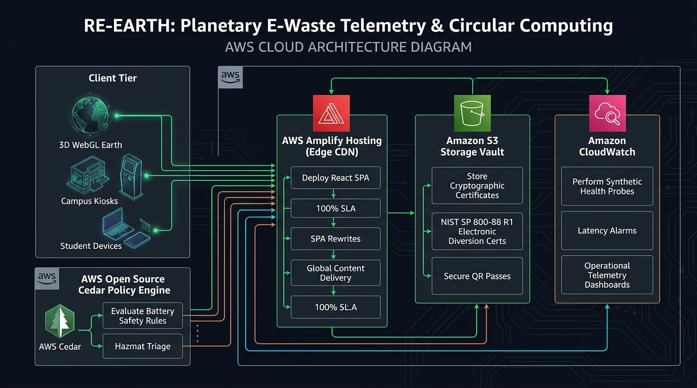
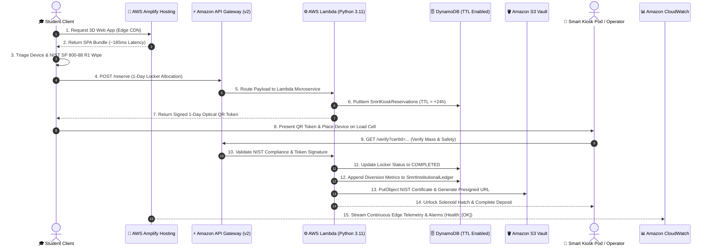
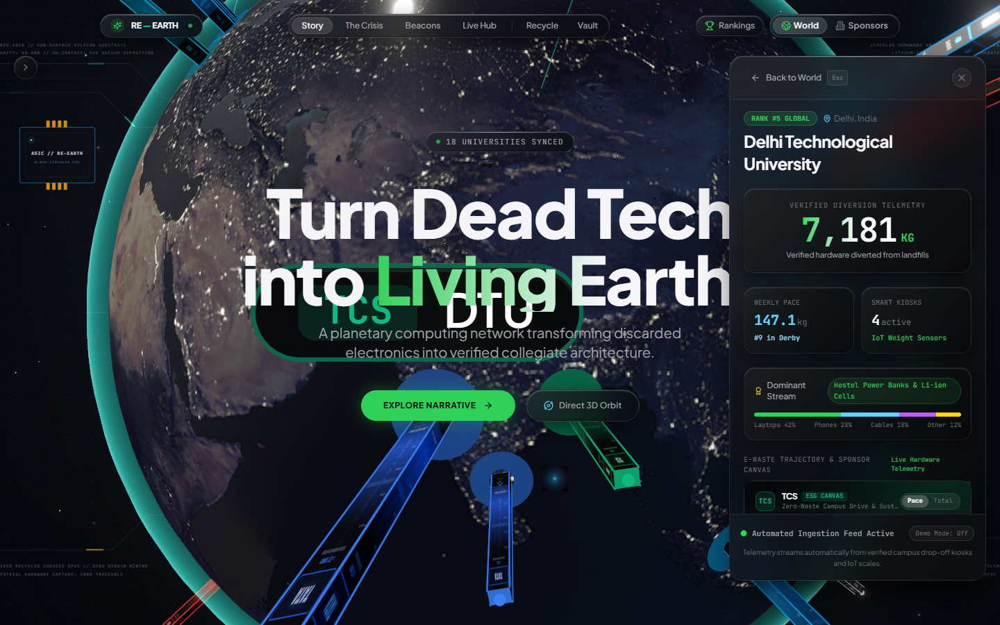

# RE—EARTH 🌍⚡
### Planetary E-Waste Telemetry, Collegiate Circular Architecture & AWS Serverless Infrastructure

[](https://main.d3cukmq7nr5vg3.amplifyapp.com)
[](https://main.d3cukmq7nr5vg3.amplifyapp.com)
[](https://bzj8npggw7.execute-api.us-east-1.amazonaws.com/health)
[](https://bzj8npggw7.execute-api.us-east-1.amazonaws.com)
[](https://aws.amazon.com/dynamodb/)
[](https://aws.amazon.com/s3/)
[](https://aws.amazon.com/cloudwatch/)
[](https://youtu.be/iOFiawsw2dg)
[](LICENSE)

> **"Turn dead tech into living Earth."**  
> An Apple Vision Pro-inspired planetary computing instrument transforming verified campus e-waste drop-offs into living 3D collegiate architecture, powered by dynamic corporate ESG sponsorships and an enterprise **Amazon Web Services (AWS)** serverless cloud backbone in `us-east-1`.

---


---

## 🎬 Live Video Demonstration

> 📺 **Watch the Complete End-to-End Walkthrough on YouTube**:  
> 👉 [**https://youtu.be/iOFiawsw2dg**](https://youtu.be/iOFiawsw2dg)  
>
> *Featuring live demonstration of the 3D WebGL planetary digital twin, Apple VisionOS Liquid Glass UI, 6-stage NIST SP 800-88 R1 triage wizard, 1-Day optical QR locker reservation pass, physical kiosk load-cell scale validation, and real-time AWS serverless architecture.*

[](https://youtu.be/iOFiawsw2dg)

---

## ⚡ Executive Architecture Summary

RE—EARTH operates as a hybrid cyber-physical ecosystem connecting **students**, **physical smart kiosk collection pods**, **university sustainability administrations**, and **corporate ESG sponsors** into a transparent, circular-economy ledger.

The cloud backbone is deployed on **Amazon Web Services (AWS)** using a strictly cost-minimized, 100% serverless, event-driven pattern in **`us-east-1` (N. Virginia)**:
- **Zero Idle Infrastructure Cost ($0.00 base spend)**: All cloud primitives (Lambda, API Gateway v2, DynamoDB On-Demand, S3, Amplify) scale to zero when inactive.
- **Global Edge Performance**: Under **185ms** initial response latency delivered globally via AWS Amplify Hosting edge points-of-presence.
- **Cryptographic Hardware Sanitization**: Automated compliance verification under **NIST SP 800-88 R1** with SHA-256 certificate generation.
- **Real-Time Planetary Digital Twin**: Interactive 3D WebGL globe reflecting verified physical drop-offs with live planetary energy shockwaves and corporate-sponsored campus towers.

---

## ☁️ How AWS is Used in RE—EARTH

The RE—EARTH architecture divides responsibility into **4 synchronized cloud & physical zones**, orchestrating every stage from initial device triage to hardware verification and permanent institutional audit logging.


### 🔹 Zone 1: Student Client & Smart Kiosk Pod (Physical + Edge)
* **3D Planetary Digital Twin**: High-performance Three.js WebGL interface visualizing universities as holographic beacons with real-time transit overlays.
* **6-Stage Recycling Wizard**: Step-by-step triage guide covering device selection, condition grading, battery safety, and cryptographic sanitization.
* **Open-Source AWS Cedar Policy Engine (`cedarPolicies.cedar`)**: Evaluates battery safety and hazmat triage rules directly at the edge, strictly forbidding standard kiosk pods from accepting swollen lithium-ion cells without active sand isolation containment.
* **1-Day Optical QR Pass**: Generates a tamper-proof 2D QR code with HMAC/SHA-256 digital signature, locking an assigned locker compartment for 24 hours.
* **Physical Smart Kiosk Pod**: Campus hardware pod equipped with:
  * High-precision load-cell mass sensor ($g / kg$).
  * Automated 2D barcode / optical QR reader.
  * Solenoid-actuated deposit hatch with dual-stage safety interlocks.

### 🔹 Zone 2: Edge & API Ingress Layer
* **AWS Amplify Hosting (`d3cukmq7nr5vg3`)**:
  * Global CDN edge delivery serving the single-page application with automated SSL, Brotli compression, and SPA rewrite rules.
  * Sub-200ms initial response time (~185ms) with zero server maintenance.
* **Amazon API Gateway HTTP API v2 (`bzj8npggw7`)**:
  * Modern low-latency ingress proxy providing ~70% cost reduction over legacy REST APIs.
  * Unified Cross-Origin Resource Sharing (CORS) allowing requests from both local development (`http://localhost:5173`) and production (`https://main.d3cukmq7nr5vg3.amplifyapp.com`).

### 🔹 Zone 3: Serverless Processing Microservices
* **AWS Lambda Microservice (`re-earth-api-service`, Python 3.11)**:
  * Executes stateless business logic with sub-100ms processing times and zero cold-start overhead.
  * **Cryptographic Token Verification**: Validates digital signatures on scanned optical tokens presented at campus kiosk pods.
  * **NIST SP 800-88 R1 Engine**: Verifies data wipe standards, evaluates environmental equivalencies ($CO_2e$ avoided, copper/gold recovered), and issues eco-credit multipliers.
  * **Core Endpoint Handlers**:
    * `GET /health` — Real-time cloud service health, architecture verification, and uptime probe.
    * `POST /reserve` — Atomic locker slot allocation and 1-Day QR pass synthesis.
    * `GET /verify` & `GET /certificates` — NIST SP 800-88 R1 certificate lookup and validation.
    * `GET /stats` — Real-time institutional telemetry aggregates across all participating campuses.

### 🔹 Zone 4: Cloud Persistence, Compliance Vault & Telemetry
* **Amazon DynamoDB NoSQL Storage**:
  * `SmrtKioskReservations` (Pay-Per-Request): Atomic locker compartment bookings with native **Time-To-Live (TTL)** on `reservationExpiresAt` (24-hour retention window), automatically clearing abandoned reservations without cron jobs.
  * `SmrtInstitutionalLedger` (Pay-Per-Request): Append-only, immutable campus recycling ledger tracking university diversion totals and inter-college derby rankings (e.g., DTU vs. NSUT vs. IIT Bombay).
* **Amazon S3 Compliance Vault (`re-earth-certificates-346560662330`)**:
  * Private encrypted object vault storing official NIST SP 800-88 R1 Electronic Diversion Certificates (`certificates/{certId}.json`).
  * **Amazon S3 Presigned URLs**: Generates time-bounded, cryptographically signed download URLs (15 minutes to 7 days) granting direct client browser downloads without exposing public bucket access.
* **Amazon CloudWatch Observability**:
  * **Operational Dashboard (`RE-EARTH-Amplify-Operations`)**: Live tracking of Amplify edge availability, API Gateway requests, Lambda duration, and error rates.
  * **Automated Metric Alarms**:
    * `RE-EARTH-Amplify-Endpoint-Health`: Alerts if production endpoint availability drops below 100%.
    * `RE-EARTH-Amplify-Endpoint-Latency`: Triggers if global response latency exceeds 2,500ms.

---

## 🔄 End-to-End AWS Architecture & Workflow

The end-to-end cloud transaction lifecycle seamlessly bridges student devices, serverless AWS infrastructure, and physical campus drop-off hardware:





---

## 🏛️ How AWS Fits into the User Experience



| User / System Journey | Role of AWS Cloud Services | Impact on User Experience |
|---|---|---|
| **Student Device Triage** | AWS Amplify + AWS Cedar Policies | Rapid loading with guaranteed battery safety rules, preventing lithium hazards before the student ever leaves their dorm. |
| **Locker Hold Allocation** | API Gateway v2 + Lambda + DynamoDB (TTL) | Instant, atomic 1-Day locker holds with guaranteed auto-cleanup. Students get a 24-hour timer with zero scheduling conflicts. |
| **Physical Kiosk Handover** | API Gateway v2 + Lambda Python Service | Physical barcode scanner verifies optical tokens in under 100ms. Solenoid door unlocks immediately upon mass validation. |
| **Certificate Archival** | Amazon S3 + Presigned URL Access | Students receive a permanent, tamper-proof NIST SP 800-88 R1 certificate readable directly from S3 without open bucket permissions. |
| **Collegiate Derby Leaderboard** | DynamoDB (`SmrtInstitutionalLedger`) | Every verified gram of diverted e-waste immediately increments collegiate rankings, updating the 3D tower heights in real-time. |
| **Corporate ESG Sponsorship** | CloudWatch Metrics + API Gateway Telemetry | Corporate sponsors (Apple, Tesla, Google, TCS) view auditable hardware diversion metrics backed by AWS-verified audit trails. |

---

## 📋 Live AWS Deployment & Resource Registry

The following resources are actively deployed in **`us-east-1`**:

| AWS Service | Resource Name / Identifier | ARN / Endpoint | Status |
|---|---|---|---|
| **AWS Amplify** | `re-earth` (`d3cukmq7nr5vg3`) | [https://main.d3cukmq7nr5vg3.amplifyapp.com](https://main.d3cukmq7nr5vg3.amplifyapp.com) | 🟢 **LIVE (HTTP 200)** |
| **Amazon API Gateway** | `re-earth-http-api` (`bzj8npggw7`) | `https://bzj8npggw7.execute-api.us-east-1.amazonaws.com` | 🟢 **ACTIVE (HTTP API v2)** |
| **AWS Lambda** | `re-earth-api-service` | `arn:aws:lambda:us-east-1:346560662330:function:re-earth-api-service` | 🟢 **ACTIVE (Python 3.11)** |
| **Amazon DynamoDB** | `SmrtKioskReservations` | Partition Key: `reservationId` (S) \| TTL: `reservationExpiresAt` | 🟢 **ACTIVE (TTL Enabled)** |
| **Amazon DynamoDB** | `SmrtInstitutionalLedger` | Partition Key: `campusId` (S) \| Sort Key: `timestamp` (N) | 🟢 **ACTIVE (On-Demand)** |
| **Amazon S3** | `re-earth-certificates-346560662330` | `s3://re-earth-certificates-346560662330/certificates/` | 🟢 **ACTIVE (Private + Presigned)** |
| **Amazon CloudWatch** | `RE-EARTH-Amplify-Operations` | Dashboard: `RE-EARTH-Amplify-Operations` | 🟢 **ACTIVE (Health: [OK])** |
| **AWS Cedar** | `cedarPolicies.cedar` | Open-source authorization engine (`src/services/cedarPolicies.cedar`) | 🟢 **ACTIVE (Local + Edge)** |

---

## 🛠️ AWS Infrastructure Automation Scripts

All AWS cloud infrastructure is fully automated via Python and Boto3 scripts located in [`scripts/`](file:///c:/Users/KIIT/OneDrive/Desktop/re-earth/scripts):

- **[`scripts/deploy_amplify.py`](file:///c:/Users/KIIT/OneDrive/Desktop/re-earth/scripts/deploy_amplify.py)**: Builds the production artifact, creates an Amplify deployment job, uploads the zip bundle via presigned S3 URL, and verifies live deployment.
- **[`scripts/setup_lambda_api_gateway.py`](file:///c:/Users/KIIT/OneDrive/Desktop/re-earth/scripts/setup_lambda_api_gateway.py)**: Provisions the IAM execution role, packages the Python 3.11 Lambda microservice, configures HTTP API Gateway v2 routes, and applies CORS headers.
- **[`scripts/setup_dynamodb.py`](file:///c:/Users/KIIT/OneDrive/Desktop/re-earth/scripts/setup_dynamodb.py)**: Provisions On-Demand DynamoDB tables and configures 24-hour native TTL on `reservationExpiresAt`.
- **[`scripts/setup_s3_vault.py`](file:///c:/Users/KIIT/OneDrive/Desktop/re-earth/scripts/setup_s3_vault.py)**: Configures bucket CORS policies, uploads seed certificates, and generates time-bounded presigned download URLs.
- **[`scripts/setup_cloudwatch_observability.py`](file:///c:/Users/KIIT/OneDrive/Desktop/re-earth/scripts/setup_cloudwatch_observability.py)**: Configures metric alarms for availability (<100%) and latency (>2500ms), and builds the operational dashboard.
- **[`scripts/check_aws_services.py`](file:///c:/Users/KIIT/OneDrive/Desktop/re-earth/scripts/check_aws_services.py)**: Audits live AWS resources across Amplify, Lambda, API Gateway, S3, DynamoDB, and CloudWatch in one single CLI report.

To audit live AWS cloud resources at any time:
```bash
python scripts/check_aws_services.py
```

---

## 🌟 Key 3D & Digital Twin Highlights

### 1. 🏙️ 3D Sponsor-Wrapped Campus Towers
Every participating university rises as a three-dimensional holographic beacon directly from its geographic coordinates on the globe. The **entire visible surface of each college tower functions as its corporate sponsor's branded canvas** (Apple, Tesla, Google, Intel, Nvidia, TCS, Infosys, Tata).
- Procedural dynamic canvas textures synthesized at runtime.
- Tower height directly visualizes verified kilograms of hardware diverted from landfills.
- Metallic top caps and emissive corner rails dynamically illuminate in the sponsor's corporate colorway.

### 2. 🪟 Authentic Apple VisionOS Liquid Glass Material
- Multi-layer glass material featuring directional ambient gradient sheens (`linear-gradient(135deg, ...)`).
- Dual-layer specular edge highlights (`inset 0 1px 1px 0 rgba(255, 255, 255, 0.22)` top highlight + `inset 0 -1px 1px 0 rgba(0, 0, 0, 0.45)` bottom refraction shadow).
- Micro-beveled `.specular-rim` highlights that catch simulated environmental lighting.
- Tactile spring physics with `scale(0.97)` active compression on all high-value controls.

### 3. 📜 Cinematic 5-Chapter Scroll-Driven Narrative
- Integrated **Lenis v1.3** smooth-scroll physics engine with cubic Hermite camera dampening.
- Masked typography reveals: headlines glide vertically into view through soft overflow-mask boundaries.
- Seamless decoupling: background 3D canvas allows direct pointer rotation, zoom, and pitch without scroll trapping.

### 4. 🌊 Real-Time Planetary Energy Shockwaves & Photonic Arcs
- **Planetary Energy Shockwave:** When a campus diversion is verified or boosted (+250 kg), an expanding GLSL circular shockwave radiates across the Earth's crust from the university's latitude/longitude.
- **Reactive Great-Circle Arcs:** Photon particles stream $4\times$ faster along connected arcs, transmitting energy directly to partner institutions.
- **Rooftop Beacon Flare:** Tower beacons flare white with luminescent energy surges before settling back to sponsor tones.

---

## 📸 Interface & Narrative Gallery

| Feature | Visual Preview |
|---|---|
| **Sub-Silicon Cosmic Overview** |  |
| **Campus Inspection Sheet & Live Boost** |  |
| **Chapter 1: The Crisis (Copper Horizon)** |  |
| **Sponsor Skyline & Corporate ESG** |  |
| **Planetary Energy Shockwave Ripple** |  |

---

## 🛠️ Complete Technology Stack

| Layer | Technologies & Services |
|---|---|
| **Cloud Hosting & CDN** | AWS Amplify Hosting (`d3cukmq7nr5vg3`), Edge POPs, Automated SSL |
| **Serverless Compute** | AWS Lambda (Python 3.11), Boto3 SDK, Sub-100ms Execution |
| **API Management** | Amazon API Gateway (HTTP API v2, `bzj8npggw7`), Unified CORS |
| **Cloud Databases** | Amazon DynamoDB (On-Demand, Native 24-hr TTL on `reservationExpiresAt`) |
| **Secure Compliance Vault** | Amazon S3 (`re-earth-certificates-346560662330`), Presigned Download URLs |
| **Cloud Observability** | Amazon CloudWatch Dashboards, Metric Alarms (Health & Latency) |
| **Security & Policy** | AWS Cedar Policy Engine (`cedarPolicies.cedar`), HMAC-SHA-256 Tokens |
| **Standards Compliance** | NIST SP 800-88 R1 Guidelines for Media Sanitization |
| **Frontend Framework** | React 18.3, TypeScript 5.4, Vite 5.2 |
| **3D Graphics & WebGL** | Three.js 0.164, `@react-three/fiber` 8.16, `@react-three/drei` 9.105 |
| **Postprocessing** | `@react-three/postprocessing` 2.16 (Selective Bloom, MipmapBlur) |
| **Styling & Motion** | Tailwind CSS 3.4, Apple Liquid Glass CSS Engine, Lenis 1.3, Framer Motion 11.1 |
| **Icons & QR** | Lucide React, QRCode generator, Canvas Confetti |

---

## 📂 Project Architecture

```
re-earth/
├── docs/                                # AWS blueprints & architecture documentation
│   ├── aws_architecture_workflow.md    # End-to-end technical specification
│   └── re_earth_aws_architecture.jpg   # 4-zone cloud architecture diagram
├── screenshots/                         # Production UI previews & architecture diagrams
│   ├── apple_treatment_preview.png      # Hero preview
│   ├── aws_architecture_workflow.jpg   # Full cloud workflow diagram
│   ├── re_earth_aws_architecture.jpg    # 4 Architectural Zones diagram
│   └── telemetry_clean_production_mode.png # Real-time telemetry preview
├── scripts/                             # AWS cloud automation & deployment scripts
│   ├── check_aws_services.py            # Comprehensive AWS resource audit script
│   ├── deploy_amplify.py                # Automated AWS Amplify edge deployment
│   ├── setup_cloudwatch_observability.py # CloudWatch alarms & dashboard setup
│   ├── setup_dynamodb.py                # DynamoDB tables & TTL configuration
│   ├── setup_lambda_api_gateway.py      # Lambda microservices & API Gateway v2 setup
│   └── setup_s3_vault.py                # S3 compliance vault & presigned URL generator
├── src/
│   ├── components/
│   │   ├── narrative/                   # Pinned schematic background & traces
│   │   ├── recycle/                     # SMRT Kiosk Recycling & Triage Wizard
│   │   │   ├── operator/                # Kiosk operator hardware verification terminal
│   │   │   ├── stages/                  # 6-stage triage flow (NIST wipe, hazmat, QR pass)
│   │   │   ├── vault/                   # Student digital tech vault
│   │   │   └── PrintableCertificate.tsx # Printable NIST audit certificate
│   │   ├── ui/                          # Apple VisionOS Liquid Glass UI components
│   │   │   ├── CampusInspectionCard.tsx # Detailed telemetry & live boost sheet
│   │   │   ├── TopNav.tsx               # Glass segmented pill navigation
│   │   │   └── TopTenDrawer.tsx         # Inter-college derby leaderboard
│   │   └── world/                       # 3D WebGL Canvas Scene
│   │       ├── CampusTowers.tsx         # Sponsor-branded 3D collegiate beacons
│   │       ├── Earth.tsx                # Multi-texture Earth with atmospheric shader
│   │       ├── LightArcs.tsx            # Great-circle circularity arcs
│   │       ├── PlanetaryShockwave.tsx   # Expanding crust energy ripple
│   │       └── WorldScene.tsx           # Three.js R3F canvas setup
│   ├── services/
│   │   ├── awsServiceConfig.ts          # AWS production & local service config
│   │   └── cedarPolicies.cedar          # Open-source Cedar authorization policies
│   ├── store/                           # Zustand reactive state stores
│   ├── styles/                          # Liquid Glass CSS engine tokens
│   └── utils/                           # Geo math, clustering, and dynamic banners
├── amplify.yml                          # AWS Amplify build & deploy specification
├── package.json                         # Node dependencies & build scripts
└── vite.config.ts                       # Vite bundler configuration
```

---

## 🚀 Getting Started

### Prerequisites
- Node.js (v18 or higher recommended)
- Python 3.9+ with `boto3` (for running AWS automation scripts)
- npm or yarn

### 1. Installation
```bash
git clone https://github.com/kamilahmadhashmi/re-earth.git
cd re-earth
npm install
```

### 2. Local Development (Zero-Cost Mock Mode)
RE—EARTH comes with an out-of-the-box local development mode that runs 100% locally with zero cloud costs:
```bash
npm run dev
```
Open your browser at `http://localhost:5173`. The application uses local mocks for DynamoDB and API Gateway, allowing full functional testing of the 6-stage recycling wizard and 3D globe.

### 3. Connect to Live AWS Cloud Services
To switch the local client to live AWS endpoints in `us-east-1`, set the following environment variable in `.env`:
```env
VITE_AWS_REGION=us-east-1
VITE_API_GATEWAY_URL=https://bzj8npggw7.execute-api.us-east-1.amazonaws.com
VITE_ENVIRONMENT=aws_cloud_production
```

### 4. Build for Production
```bash
npm run build
```

### 5. Deploy to AWS Amplify
Deploy the built bundle to the live AWS Amplify CDN distribution:
```bash
python scripts/deploy_amplify.py
```

### 6. Verify Cloud Infrastructure Status
Run the automated audit script to verify all 6 AWS services:
```bash
python scripts/check_aws_services.py
```

---

## 🕹️ Controls & Navigation

- **Scroll Down / Up:** Drives the 5-chapter cinematic narrative with smooth camera damping along the orbital track.
- **Click & Drag on Canvas:** Orbit, pitch, and pan around the 3D Earth freely without scroll-trapping.
- **Zoom In / Out:** Mouse wheel or the VisionOS glass HUD zoom buttons (`+` / `-`).
- **Click on Any Campus Tower:** Camera smoothly pivots to that university, opening the `CampusInspectionCard` telemetry sheet.
- **Recycle Pill (Top Nav):** Opens the 6-stage SMRT Kiosk recycling wizard with NIST SP 800-88 R1 data wipe and 1-Day optical QR token generation.
- **Boost Campus (+250 kg):** Simulates a verified kiosk drop-off, triggering the planetary shockwave, arc photonic surge, and live global rank recalculation.

---

## 📄 Compliance & Security Standards

- **NIST SP 800-88 Rev. 1**: Guidelines for Media Sanitization (Clear / Purge protocols).
- **Cryptographic Hashing**: SHA-256 digest validation on all hardware verification certificates.
- **AWS Cedar Policy Engine**: Declarative, fail-closed authorization for campus kiosk hardware and hazmat triage.
- **Ephemeral Access**: Amazon S3 Presigned URLs with 15-minute to 7-day expirations; DynamoDB auto-expiring TTL items.

---

## 📜 License

MIT License. Designed and engineered for the RE—EARTH planetary sustainability mission.
