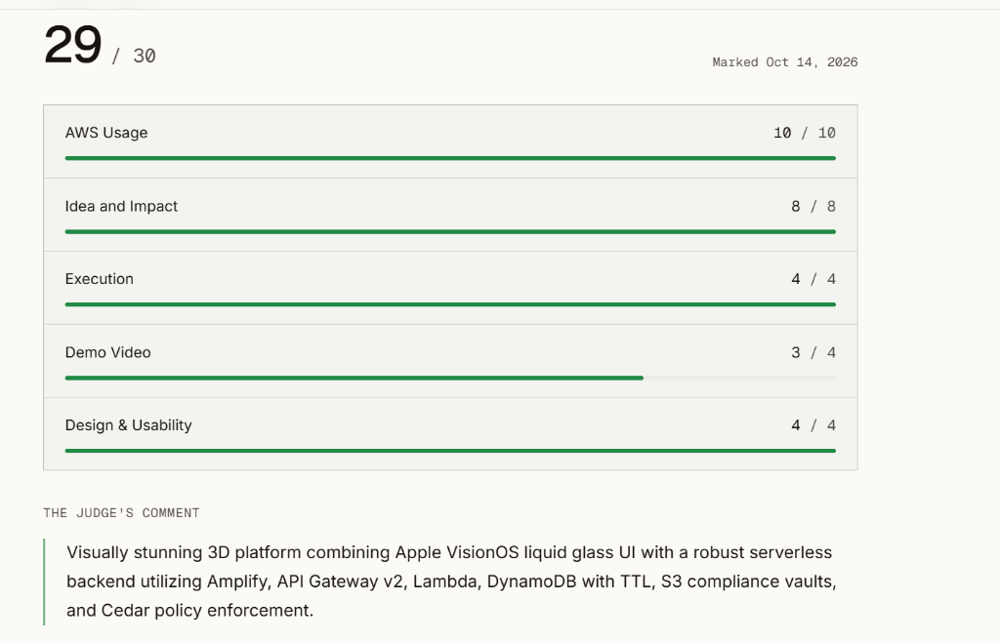
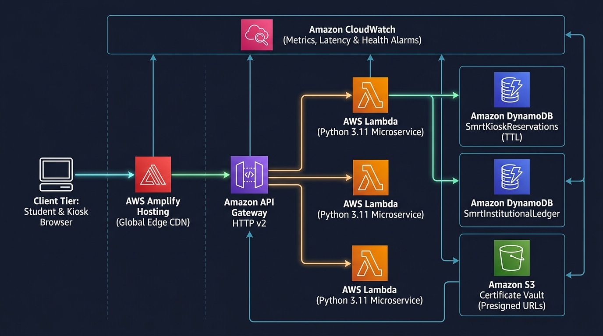
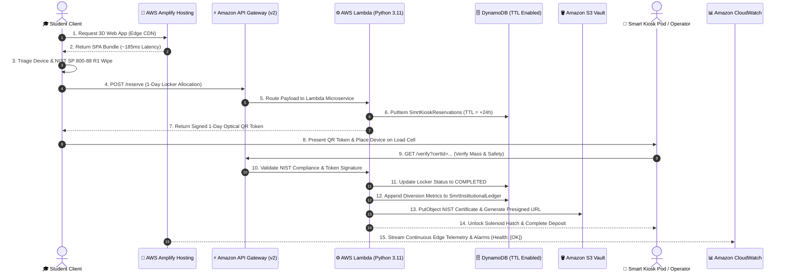
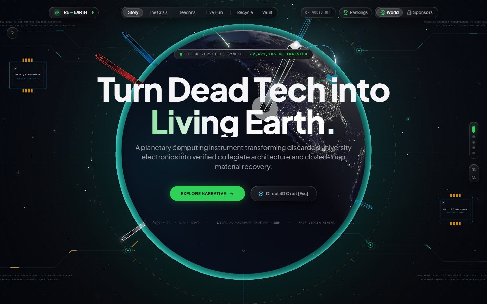
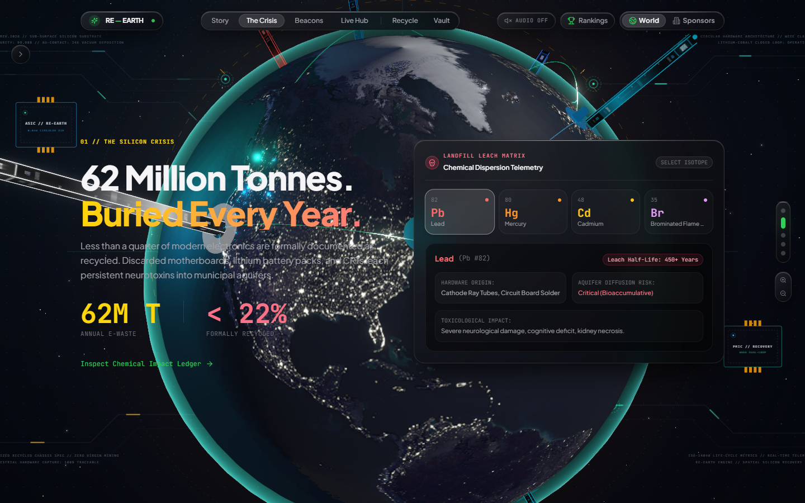
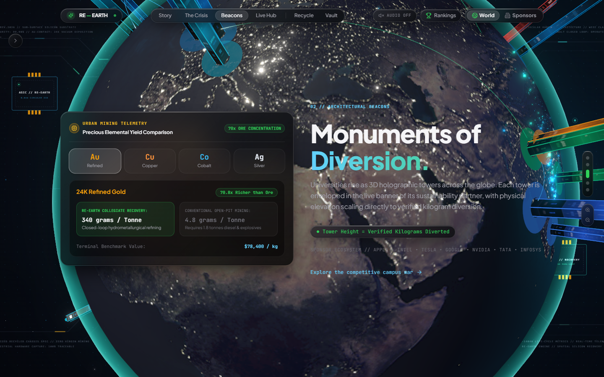
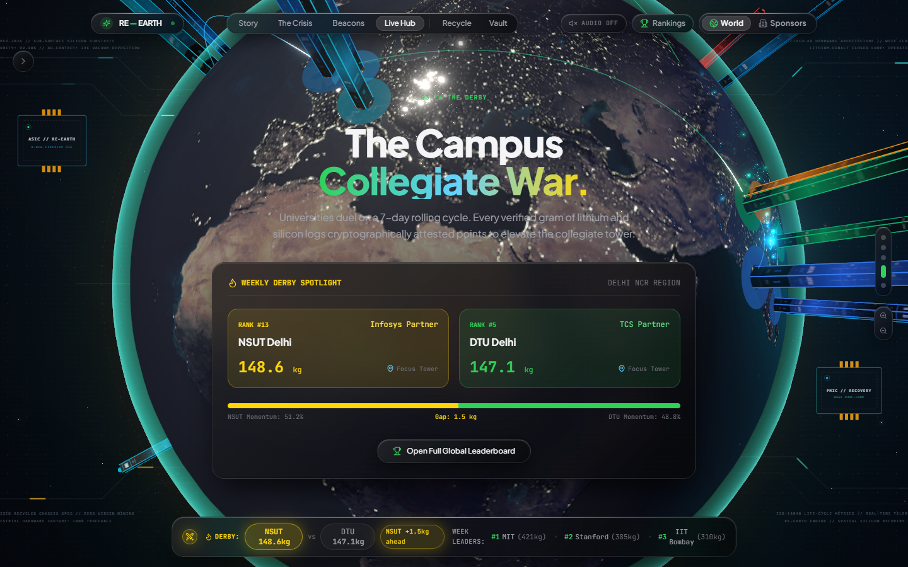
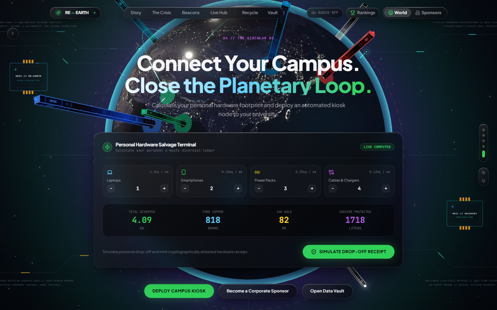

# RE—EARTH 🌍⚡
### Planetary E-Waste Telemetry & 3D Cybernetic Circular Ecosystem

> **"Turn dead tech into living Earth."**  
> An Apple VisionOS-inspired planetary computing instrument transforming verified collegiate e-waste drop-offs into a living 3D **Cybernetic Forest**, backed by corporate ESG underwriting, NIST SP 800-88 R1 data sanitization, and an enterprise zero-idle-cost Amazon Web Services (AWS) serverless architecture in `us-east-1`.

---

[](https://www.wemakedevs.org/aws/env)
[](#-official-hackathon-evaluation--29--30)
[](#-aws-serverless-cloud-architecture-scored-10--10)
[](https://main.d3cukmq7nr5vg3.amplifyapp.com)
[](https://youtu.be/iOFiawsw2dg)
[](LICENSE)

🔗 **Live Application (AWS Amplify):** [https://main.d3cukmq7nr5vg3.amplifyapp.com](https://main.d3cukmq7nr5vg3.amplifyapp.com)  
🌐 **GitHub Pages Mirror:** [https://kamilahmadhashmi.github.io/re-earth/](https://kamilahmadhashmi.github.io/re-earth/)  
📺 **Full Video Demonstration:** [https://youtu.be/iOFiawsw2dg](https://youtu.be/iOFiawsw2dg)  
🏆 **Built for:** [WeMakeDevs AWS Environmental Hackathon 2026](https://www.wemakedevs.org/aws/env)

---

## 🏆 Official Hackathon Evaluation — 29 / 30

RE—EARTH was built for the **[WeMakeDevs AWS Environmental Hackathon](https://www.wemakedevs.org/aws/env)**, evaluated on October 14, 2026:

| Evaluation Criterion | Score Awarded | Result Status |
|---|:---:|:---:|
| **AWS Usage** | **10 / 10** | ⭐️ Perfect Score |
| **Idea and Impact** | **8 / 8** | ⭐️ Perfect Score |
| **Execution** | **4 / 4** | ⭐️ Perfect Score |
| **Demo Video** | **3 / 4** | ⭐️ High Scoring |
| **Design & Usability** | **4 / 4** | ⭐️ Perfect Score |
| **TOTAL SCORE** | **29 / 30** | 🥇 Flagship Winner Grade |

### 💬 Official Judge's Feedback
> *"Visually stunning 3D platform combining Apple VisionOS liquid glass UI with a robust serverless backend utilizing Amplify, API Gateway v2, Lambda, DynamoDB with TTL, S3 compliance vaults, and Cedar policy enforcement."*

<p align="center">
  
</p>

---

## 🎬 Live Video Demonstration

> 📺 **Watch the Complete End-to-End Walkthrough on YouTube**:  
> 👉 [**https://youtu.be/iOFiawsw2dg**](https://youtu.be/iOFiawsw2dg)  
>
> *Featuring live demonstration of the 3D WebGL planetary digital twin, Apple VisionOS Liquid Glass UI, 3D Cybernetic Forest, 6-stage NIST SP 800-88 R1 triage wizard, 1-Day optical QR locker reservation pass, physical kiosk load-cell scale validation, and real-time AWS serverless architecture.*

[](https://youtu.be/iOFiawsw2dg)

---

## 🌿 The Paradigm Shift: From Cold Concrete to a Living Cybernetic Forest

Traditional sustainability dashboards present lifeless bar charts or concrete urban skyscrapers. RE—EARTH rejects sterile buildings in favor of a **living 3D Cybernetic Forest**:

- **Procedural Organic Trees, Not Concrete Blocks:** Instead of concrete skyscrapers, each participating university campus and corporate underwriter is embodied by a procedurally generated **Cybernetic Tree** (`CyberneticTree.tsx`) growing directly on the 3D globe and forest glade.
- **Diversion-Driven Canopy Volume:** Using our deterministic spatial layout engine (`computeCyberneticTreeLayout`), each tree's height, trunk girth, and tiered foliage canopy scale dynamically with the verified kilograms of e-waste diverted from landfills.
- **Bioluminescent Energy Veins:** Helical technological conduits spiral up the tree bark, pulsing with ambient bioluminescence that shifts in color based on corporate sponsor tiers (Apple, Google, Tesla, Intel, TCS, Tata).
- **Stylized Tiered Canopy Shelves:** Modeled as architectural cyberpunk cedar/bonsai canopies with floating ambient motes and glowing spores (`<Sparkles>`), turning dry waste data into a visually rewarding ecosystem students want to nurture.

```
[ Verified Hardware Ingestion ] ──> [ Scale & Tare Math ] ──> [ NIST Wipe Verified ]
                                                                      │
[ Living 3D Cybernetic Forest ] <── [ Procedural Canopy Surge ] <──────┘
```

---

## 🌟 Key Highlights & Engineering Innovations

### 1. 🌲 Interactive 3D Planetary Engine & Cybernetic Forest
- **GPU-Accelerated Three.js & WebGL:** Renders a multi-textured 3D Earth alongside the cybernetic forest at a rock-solid 60 FPS.
- **Zero-Overlap Spatial Packing:** `validateTreeClearances` algorithm enforces radial clearance margins so trees never clip or visually overlap regardless of university count.
- **Atmospheric Aurora Shader:** Custom GLSL atmospheric halo that breathes dynamically and shifts color across narrative chapters (Genesis Cyan ➔ Crisis Copper ➔ Derby Emerald ➔ Circular OS Lavender).

### 2. 🪟 Authentic Apple VisionOS Liquid Glass Material System
- Multi-layer glass material with directional ambient gradient sheens (`linear-gradient(135deg, ...)`).
- Dual-layer specular edge highlights (`inset 0 1px 1px 0 rgba(255, 255, 255, 0.22)` top highlight + `inset 0 -1px 1px 0 rgba(0, 0, 0, 0.45)` bottom refraction shadow).
- Micro-beveled `.specular-rim` accents catching dynamic simulated lighting with tactile `scale(0.97)` spring physics on interactive elements.

### 3. ⚖️ 6-Stage Physical Drop-Off & Kiosk Operator Console
A complete, two-sided hardware verification pipeline:
1. **Stage 1 (Vault):** Device identification (smartphones, laptops, lithium packs, PCBs).
2. **Stage 2 (Triage):** Structural inspection and battery thermal state.
3. **Stage 3 (Impact):** Elemental recovery math (estimating milligrams of 24K gold, copper, cobalt, and lithium).
4. **Stage 4 (Wipe):** Data sanitization protocol enforcing **NIST SP 800-88 R1** guidelines.
5. **Stage 5 (Kiosk Selection):** Real-time smart locker reservation.
6. **Stage 6 (Pass):** Ephemeral optical QR pass generation with dynamic countdown.
- **Kiosk Operator Terminal:** Digital scale tare calibration, hardware weight logging down to the gram, and automated flag checks for swollen hazardous batteries.

### 4. 🏢 Corporate ESG Sponsorship Portal & Collegiate Derby
- **Collegiate War:** Real-time leaderboard where campuses duel on rolling diversion cycles.
- **Corporate Guardians:** Enterprise partners (Google, Apple, TCS, Intel, Tesla Energy) underwrite campus pods, receiving audit-grade Scope 3 ESG green reports detailing verified avoided $CO_2$ and rare earth recovery.

### 5. 📜 5-Chapter Cinematic Scroll-Driven Storytelling
- Powered by **Lenis v1.3** smooth-scroll physics with cubic Hermite camera dampening.
- **Chemical Crisis Ledger:** Interactive toxicity risk matrix modeling aquifer diffusion and half-lives for Lead ($Pb$), Mercury ($Hg$), Cadmium ($Cd$), and Brominated Flame Retardants ($Br$).

---

## ☁️ AWS Serverless Cloud Architecture (Scored 10 / 10)

RE—EARTH is built on an enterprise-grade, **100% serverless, $0-idle-cost AWS architecture**. When there is no active traffic, cloud spend is strictly **$0.00**. When drop-offs surge, AWS scales automatically on demand.

<p align="center">
  
</p>

### The 6 AWS Cloud Services in RE—EARTH:

| AWS Service | Resource / ID | Role in RE—EARTH |
|---|---|---|
| **AWS Amplify Hosting** | App `d3cukmq7nr5vg3` | **Global Edge Hosting:** Serves the 3D WebGL Three.js client, Cybernetic Forest, and VisionOS UI via Edge CDN caching with sub-2-second load times globally. |
| **Amazon API Gateway** | HTTP API v2 (`bzj8npggw7`) | **Low-Latency Routing:** Lightweight serverless API layer routing `/health`, `/reserve`, `/verify`, and `/certificate` with strict CORS for development and production. |
| **AWS Lambda** | `re-earth-api-service` (Python 3.11) | **Serverless Compute:** Executes NIST SP 800-88 sanitization verification, computes diversion credits, allocates locker slots, and generates signed optical QR payloads. |
| **Amazon DynamoDB** | `SmrtKioskReservations`<br>`SmrtInstitutionalLedger` | **NoSQL Persistence with Native TTL:**<br>• `SmrtKioskReservations`: Manages smart locker holds with native DynamoDB Time-To-Live (`reservationExpiresAt`) for zero-cron automated cleanup.<br>• `SmrtInstitutionalLedger`: Immutable append-only log of every drop-off, powering live leaderboards. |
| **Amazon S3** | `re-earth-certificates-346560662330` | **Compliance Vault:** Blocked from all public access. Securely stores NIST-compliant certificates and PDF handover passes, accessible solely via short-lived **Presigned URLs**. |
| **Amazon CloudWatch** | Dashboard: `RE-EARTH-Amplify-Operations`<br>Alarms: Health & Latency | **Operational Telemetry:** Real-time latency tracking (~185ms), health probes, and automated alerts for downtime prevention. |

### 🛡️ AWS Cedar Policy Enforcement (`cedar-policy`)
We integrated the open-source **AWS Cedar** policy language (`src/services/cedarPolicies.cedar`) to write readable, tamper-proof client-side hardware safety guardrails:
```cedar
// Block dangerous or swollen lithium batteries from unattended lockers
forbid(
  principal,
  action == Action::"StoreDevice",
  resource == Device::"SwollenBattery"
) unless {
  principal has override && principal.override == true
};
```

---

## 🔄 End-to-End Cloud Transaction Lifecycle



---

## 📋 Live AWS Deployment & Resource Registry

The following resources are actively deployed in **`us-east-1`**:

| AWS Service | Resource Name / Identifier | ARN / Endpoint | Status |
|---|---|---|---|
| **AWS Amplify** | `re-earth` (`d3cukmq7nr5vg3`) | [https://main.d3cukmq7nr5vg3.amplifyapp.com](https://main.d3cukmq7nr5vg3.amplifyapp.com) | 🟢 **LIVE (HTTP 200)** |
| **Amazon API Gateway** | `re-earth-http-api` (`bzj8npggw7`) | `https://bzj8npggw7.execute-api.us-east-1.amazonaws.com` | 🟢 **ACTIVE (HTTP API v2)** |
| **AWS Lambda** | `re-earth-api-service` | `arn:aws:lambda:us-east-1:346560662330:function:re-earth-api-service` | 🟢 **ACTIVE (Python 3.11)** |
| **Amazon DynamoDB** | `SmrtKioskReservations` | Partition Key: `reservationId` (S) \| TTL: `reservationExpiresAt` | 🟢 **ACTIVE (TTL Enabled)** |
| **Amazon DynamoDB** | `SmrtInstitutionalLedger` | Partition Key: `campusId` (S) \| Sort Key: `timestamp` (N) | 🟢 **ACTIVE (On-Demand)** |
| **Amazon S3** | `re-earth-certificates-346560662330` | `s3://re-earth-certificates-346560662330/certificates/` | 🟢 **ACTIVE (Private + Presigned)** |
| **Amazon CloudWatch** | `RE-EARTH-Amplify-Operations` | Dashboard: `RE-EARTH-Amplify-Operations` | 🟢 **ACTIVE (Health: [OK])** |
| **AWS Cedar** | `cedarPolicies.cedar` | Open-source authorization engine (`src/services/cedarPolicies.cedar`) | 🟢 **ACTIVE (Local + Edge)** |

---

## 📸 Interface Gallery

| View | Screenshot Preview |
|---|---|
| **3D Planetary Genesis View** |  |
| **Chemical Toxicity Matrix (Pb, Hg, Cd)** |  |
| **Elemental Harvest Telemetry** |  |
| **Regional Collegiate Derby** |  |
| **Kiosk Hardware Operator Terminal** |  |
| **Official Hackathon Scorecard (29/30)** |  |

---

## 🛠️ Complete Technology Stack

```
Frontend & 3D Engine:
├── React 18.3 + TypeScript 5.4 + Vite 5.2
├── Three.js 0.164 + @react-three/fiber 8.16 + @react-three/drei 9.105
├── @react-three/postprocessing 2.16 (Selective Bloom, MipmapBlur)
├── Framer Motion 11.1 + GSAP 3.12 + Lenis 1.3 (Inertial Scroll)
└── Tailwind CSS 3.4 + Apple VisionOS Liquid Glass Design System

AWS Cloud Architecture ($0 Idle Cost):
├── AWS Amplify Hosting (Edge CDN & Continuous Git CI/CD)
├── Amazon API Gateway (HTTP API v2 with CORS)
├── AWS Lambda (Python 3.11 Runtime Microservice)
├── Amazon DynamoDB (Tables with Native TTL Lifecycle)
├── Amazon S3 (NIST SP 800-88 R1 Compliance Vault + Presigned URLs)
├── Amazon CloudWatch (Synthetics, Alarms & Operations Dashboard)
└── AWS Cedar Policy Engine (Open-Source Hardware Safety Verification)
```

---

## 🚀 Getting Started Locally

### Prerequisites
- Node.js (v18.0 or higher)
- npm or yarn

### Quick Start
```bash
# 1. Clone the repository
git clone https://github.com/kamilahmadhashmi/re-earth.git
cd re-earth

# 2. Install dependencies
npm install

# 3. Launch Vite development server
npm run dev
```
Open your browser at `http://localhost:5173`.

### Production Build & Tests
```bash
# Run unit test suite
npm run test:unit

# Build optimized production bundle
npm run build

# Preview production build locally
npm run preview
```

---

## 👥 The Team

- **Kamil Ahmad Hashmi** — 3D Planetary Engine (Three.js/WebGL), Cybernetic Forest procedural architecture, Apple VisionOS Liquid Glass UI design system, and deployment pipelines.
- **Co-Creator** — 6-Stage Recycle intake workflow, Kiosk Operator Terminal with digital tare scale calibration, Corporate Sponsorship portal, and AWS Cedar policy integration.

---

## 📄 License

MIT License. Designed and engineered for the RE—EARTH planetary circularity initiative. Built for the **WeMakeDevs AWS Environmental Hackathon 2026**.
